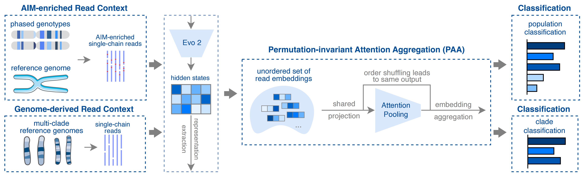

# EvoGR (Evo 2-based Genomic Representation)

This repository implements EvoGR, the method proposed in **Structure-aware transfer of pretrained genomic representations for population and cross-clade classification**.

## Model Architecture



## Quick Start

### 1. Install dependencies

We recommend Python 3.10 or later and a Linux environment with CUDA acceleration for Evo 2 inference.

```bash
python -m venv .venv
source .venv/bin/activate
pip install -r requirements.txt
```

Set the source paths:

```bash
export PYTHONPATH="$PWD/population/src:$PWD/cross_clade/src:$PYTHONPATH"
```
### 2. Download the Evo 2 checkpoint

Download link: https://huggingface.co/arcinstitute/evo2_7b_base/resolve/main/evo2_7b_base.pt

### 3. Population/Cross-clade classification

After preparing the input data and Evo 2 checkpoint, run the full pipeline:

```bash
python population/scripts/run_pipeline.py
```
